<div align="center">

  <!-- Animated Neon Hero Banner -->
  <a href="https://github.com/dhruv-lx/qovrix">
    
  </a>

  <br/><br/>

  <!-- Dynamic Typing SVG Headline -->
  <a href="https://github.com/dhruv-lx/qovrix">
    
  </a>

  <p align="center">
    <b>Lightweight • Zero Dependencies • Hardware Accelerated • Offline First</b>
  </p>

  <p align="center">
    <a href="https://github.com/dhruv-lx/qovrix/stargazers"></a>
    <a href="https://github.com/dhruv-lx/qovrix/network/members"></a>
    <a href="https://github.com/dhruv-lx/qovrix/blob/main/LICENSE"></a>
    <a href="#-curated-templates"></a>
    <a href="https://github.com/dhruv-lx"></a>
  </p>

  <p align="center">
    <a href="#-quick-start"><b>⚡ Quick Start</b></a> •
    <a href="#-features"><b>✨ Features</b></a> •
    <a href="#-curated-templates"><b>📐 113+ Templates</b></a> •
    <a href="#-architecture"><b>🏛️ Architecture</b></a> •
    <a href="#-keyboard-shortcuts"><b>⌨️ Shortcuts</b></a> •
    <a href="#-license"><b>📄 License</b></a>
  </p>

</div>

---

## ⚡ Overview

**QOVRIX** is a standalone, client-side vector graphic design studio built from scratch on vanilla HTML5 Canvas. It gives creators and developers the power to compose high-resolution banners, YouTube thumbnails, Instagram posts, stories, and commercial brand collateral right inside their browser.

Unlike bloated electron wrappers or cloud-walled tools, **QOVRIX requires zero installation, zero compilation steps, and zero server backends**. Launch it directly from disk or host it on any static provider (GitHub Pages, Vercel, Netlify) with instant zero-latency startup.

---

<a id="architecture"></a>
<a id="-architecture"></a>
## 🏛️ Architecture & Engine Pipeline

QOVRIX is engineered around an **uncompromising client-side pipeline** that moves from curated mathematical templates to a real-time hardware-accelerated 2D canvas, finishing in high-dpi vector export:

<div align="center">
  
</div>

<br/>

```
┌────────────────────────┐      ┌─────────────────────────┐      ┌─────────────────────────┐
│  Curated Template Hub  │ ───> │ Brand Injection Engine  │ ───> │ Canvas 2D Vector Core   │
│  (113+ Presets / JSON) │      │ ({{NAME}}, {{PHONE}}...) │      │ (Sub-pixel rendering)   │
└────────────────────────┘      └─────────────────────────┘      └─────────────────────────┘
                                                                              │
                                                                              ▼
                                                                 ┌─────────────────────────┐
                                                                 │ High-Res Retina Export  │
                                                                 │ (2X PNG, 95% JPG, PDF)  │
                                                                 └─────────────────────────┘
```

---

## ✨ Features at a Glance

<table>
  <tr>
    <td width="50%" valign="top">
      <h3>🎨 Visual Canvas Studio</h3>
      <ul>
        <li><b>Pure Canvas 2D Engine:</b> Hardware-accelerated sub-pixel typography and vector geometry rendering.</li>
        <li><b>Rich Geometry & Vectors:</b> Rounded rectangles, circles, stars, hearts, triangles, and arrows with stroke and corner radius controls.</li>
        <li><b>Freehand Brush Studio:</b> Fluid freehand drawing engine with adjustable brush radius, dynamic opacity, and color palettes.</li>
        <li><b>Layer Stacking Control:</b> Full z-index reordering (Bring Forward, Send Backward), horizontal/vertical flipping, and element locking.</li>
      </ul>
    </td>
    <td width="50%" valign="top">
      <h3>📐 113+ Mathematically Aligned Presets</h3>
      <ul>
        <li><b>Golden Ratio Precision:</b> Every element is positioned with strict positive clearance — zero overlaps, zero collisions, zero clipping.</li>
        <li><b>Multi-Ratio Canvases:</b> Instant presets for YouTube Banners (16:9), Thumbnails (16:9), Instagram Square (1:1), Stories & Reels (9:16), and Commercial Posters (4:5).</li>
        <li><b>14 Industry Verticals:</b> Esports, Technology, Crypto, Dining, Gym/Fitness, Real Estate, Education, Fashion, Events, Travel, and Flash Sales.</li>
      </ul>
    </td>
  </tr>
  <tr>
    <td width="50%" valign="top">
      <h3>🏢 Dynamic Brand Identity Kit</h3>
      <ul>
        <li><b>Single-Source Profile:</b> Configure your Business Name, Phone, Website, Address, and Tagline once.</li>
        <li><b>Automatic Interpolation:</b> Placeholders like <code>{{BUSINESS_NAME}}</code>, <code>{{PHONE}}</code>, and <code>{{WEBSITE}}</code> dynamically inject into opened templates in real-time.</li>
        <li><b>Local Persistence:</b> Stored safely in <code>localStorage</code> with zero telemetry.</li>
      </ul>
    </td>
    <td width="50%" valign="top">
      <h3>🌓 Adaptive Dual Theme & Fullscreen</h3>
      <ul>
        <li><b>Cyberpunk Dark Mode:</b> Obsidian background with high-visibility electric lime (<code>#76ff03</code>) and cyan accents.</li>
        <li><b>Daylight Studio Mode:</b> Clean, high-contrast light theme built for daylight editorial production.</li>
        <li><b>Distraction-Free Mode:</b> Press <kbd>F</kbd> to enter full-width fullscreen mode with auto-scaling responsive canvas stages.</li>
      </ul>
    </td>
  </tr>
  <tr>
    <td width="50%" valign="top">
      <h3>📤 Multi-Format High-Res Export</h3>
      <ul>
        <li><b>Retina 2X PNG:</b> Crisp pixel-perfect raster export with transparent or solid background fills.</li>
        <li><b>Compressed JPG (95%):</b> Lightweight compression with pristine visual sharpness for web and social feeds.</li>
        <li><b>Print-Ready Vector PDF:</b> Direct client-side PDF document generation via embedded <code>jsPDF</code>.</li>
      </ul>
    </td>
    <td width="50%" valign="top">
      <h3>💾 Offline-First Resilience</h3>
      <ul>
        <li><b>Zero-Latency Offline Mode:</b> Pre-packaged with embedded fallback catalogs; functions completely without Wi-Fi.</li>
        <li><b>Optional Supabase Cloud:</b> Optional plug-and-play Supabase sync for cross-device projects and account auth.</li>
      </ul>
    </td>
  </tr>
</table>

---

<a id="curated-templates"></a>
<a id="-curated-templates"></a>
## 📐 113+ Curated Templates Catalog

Every template has been mathematically calculated for horizontal and vertical harmony:

| Category | Dimensions | Ratio | Count | Featured Artboards |
| :--- | :---: | :---: | :---: | :--- |
| **YouTube Channel Banners** | 1200 × 675 | 16:9 | 10 | *Neon Protocol, Byte & Silicon, Bull Market Alpha, Midnight Frequency* |
| **YouTube Thumbnails** | 1280 × 720 | 16:9 | 10 | *10X Growth Blueprint, Top Coding Disasters, $15,000 Dream Desk Tour* |
| **Instagram Square Posts** | 1080 × 1080 | 1:1 | 12 | *Smoked Brisket Stack, Silk & Linen Summer Drop, Skyline Duplex, 50% Off* |
| **Instagram Stories & Reels** | 1080 × 1920 | 9:16 | 10 | *Midnight Flash Sale, Podcast Episode 48, 7-Day Core Challenge* |
| **Corporate & Business** | 800 × 1000 | 4:5 | 10 | *Strategic Advisory, Hyperscale Cloud, Commercial Litigation, FinTech AI* |
| **Food & Restaurants** | 800 × 1000 | 4:5 | 8 | *Neapolitan Pizza, Wagyu Steakhouse, Omakase Sushi Bar, Craft Taproom* |
| **Gym & Fitness** | 800 × 1000 | 4:5 | 8 | *Total Body Shred, Olympic Barbell Club, Sound Sanctuary, Fight Club* |
| **Real Estate & Property** | 800 × 1000 | 4:5 | 8 | *Cantilever Glass Villa, Tribeca Skyline Penthouse, Beachfront Retreat* |
| **Education & Courses** | 800 × 1000 | 4:5 | 8 | *Full-Stack Bootcamp, UX Design Sprint, Python Data Science, SAT Prep* |
| **Healthcare & Clinics** | 800 × 1000 | 4:5 | 6 | *Advanced Dental Implants, Dermatology Clinic, Vision Care, Wellness* |
| **Fashion & Luxury** | 800 × 1000 | 4:5 | 6 | *Haute Couture Runway, Swiss Chronographs, Handcrafted Leather Drop* |
| **Events & Festivals** | 800 × 1000 | 4:5 | 6 | *Electronic Music Festival, Rooftop Jazz Lounge, Stand-Up Comedy Night* |
| **Travel & Tourism** | 800 × 1000 | 4:5 | 5 | *Swiss Alpine Trek, Bali Wellness Sanctuary, Tokyo Cultural Expedition* |
| **Commercial Flash Sales** | 800 × 1000 | 4:5 | 6 | *Midnight Clearance, BOGO Promo, Spring Warehouse Liquidation* |

---

<a id="quick-start"></a>
<a id="-quick-start"></a>
## ⚡ Quick Start

### 1. Direct Browser Launch (No Install Required)
You don't even need Node.js or a web server! Simply double-click [`index.html`](file:///index.html) in your file manager to open QOVRIX immediately in Google Chrome, Brave, Firefox, Safari, or Microsoft Edge.

### 2. Run Local Development Server

```bash
# 1. Clone the repository
git clone https://github.com/dhruv-lx/qovrix.git

# 2. Enter directory
cd qovrix

# 3. Launch with npm
npm start

# Or serve directly via npx
npx serve . -l 3000
```

Open **[http://localhost:3000](http://localhost:3000)** in your browser.

---

<a id="keyboard-shortcuts"></a>
<a id="-keyboard-shortcuts"></a>
## ⌨️ Keyboard Shortcuts

| Key Binding | Functionality |
| :---: | :--- |
| <kbd>Ctrl</kbd> + <kbd>Z</kbd> | Undo last action on canvas |
| <kbd>Ctrl</kbd> + <kbd>Y</kbd> | Redo action on canvas |
| <kbd>Delete</kbd> / <kbd>Backspace</kbd> | Remove currently selected element |
| <kbd>Arrow Keys</kbd> | Micro-nudge selected layer by 1px |
| <kbd>Shift</kbd> + <kbd>Arrow Keys</kbd> | Fast-nudge selected layer by 10px |
| <kbd>F</kbd> | Toggle distraction-free Fullscreen workspace |
| <kbd>Ctrl</kbd> + <kbd>S</kbd> | Quick-save project to local storage library |
| <kbd>Esc</kbd> | Clear active selection / Close open modals |

---

## 📁 Repository Structure

```
qovrix/
├── index.html              # QOVRIX Studio Dashboard (Explore, Hub, Library, Brand)
├── editor.html             # Full Visual Canvas Vector Design Studio
├── login.html              # Authentication & User Workspace Portal
├── templates.html          # Router forwarder to Templates Hub (#templates)
├── projects.html           # Router forwarder to Saved Library (#library)
├── templates.json          # 113+ production-ready vector template definitions
├── supabase-config.js      # Zero-latency fallback catalog & optional DB client
├── qovrix-logo.jpg         # Official QOVRIX Brand Identity Logo
├── package.json            # Development server scripts and package manifest
├── package-lock.json       # Dependency lockfile
├── .gitignore              # Open-source security rules
├── LICENSE                 # Official MIT Open Source License
├── README.md               # Visual project documentation
│
├── assets/                 # High-Resolution Animated SVG Vectors
│   ├── hero-banner.svg     # Animated cyber-neon hero banner
│   └── pipeline.svg        # Animated architecture workflow diagram
│
├── js/                     # Studio Tool Extensions
│   ├── aiTextGenerator.js  # Client-side AI copywriter with local key storage
│   ├── autoColorPalette.js # Dynamic image & logo color palette extractor
│   ├── brandKit.js         # Business profile state manager
│   ├── magicResize.js      # Multi-ratio canvas resizer
│   └── variationsEngine.js # Design variation generator
│
├── database/               # SQL Database Migrations
│   ├── database-schema.sql # PostgreSQL / Supabase schema for cloud sync
│   └── sample-templates.sql# Initial database seed templates
│
├── docs/                   # Architectural & Engineering Specifications
│   ├── AUTO_SCALE_SYSTEM.md
│   ├── CANVAS_SIZING_FIX.md
│   ├── ELEMENT_ALIGNMENT_SYSTEM.md
│   ├── ELEMENT_SCALING_SYSTEM.md
│   └── ...
│
├── scripts/                # Build & Catalog Tooling
│   └── generate-100-templates.js # Mathematical template generator script
│
└── icon/                   # UI Vector SVGs & Favicon Assets
```

---

<details>
<summary><b>☁️ Connecting Optional Supabase Cloud Sync (Click to Expand)</b></summary>
<br/>

By default, QOVRIX runs **100% offline** with zero configuration. If you wish to connect your own free Supabase cloud database:

1. Create a free account at [Supabase](https://supabase.com).
2. Open your Supabase SQL Editor and execute [`database/database-schema.sql`](file:///database/database-schema.sql).
3. Set your project URL and Anon key in [`supabase-config.js`](file:///supabase-config.js) or paste them directly into your browser console:
   ```javascript
   localStorage.setItem('qovrix_supabase_url', 'https://your-project.supabase.co');
   localStorage.setItem('qovrix_supabase_anon_key', 'your-anon-key');
   ```
</details>

---

## 🛠️ Tech Stack & Dependencies

* **Core Engine:** Pure HTML5 Canvas 2D API (`canvas.getContext('2d')`)
* **Styling & Theming:** Vanilla CSS3 with CSS Custom Properties (Variables)
* **Icons:** FontAwesome 6.4.0 & Clean Vector SVGs
* **Typography:** Google Fonts (`Space Grotesk`, `Plus Jakarta Sans`, `Montserrat`, `JetBrains Mono`)
* **Vector Document Export:** `html2canvas` & `jspdf`
* **Zero Runtime Dependencies:** Built purely on standard web APIs

---

## 🤝 Contributing

Contributions are warmly welcomed! If you'd like to add new templates or features:

1. Fork the Repository (`https://github.com/dhruv-lx/qovrix`)
2. Create your Feature Branch (`git checkout -b feature/NewFeature`)
3. Commit your Changes (`git commit -m 'Add NewFeature'`)
4. Push to the Branch (`git push origin feature/NewFeature`)
5. Open a Pull Request

---

<a id="license"></a>
<a id="-license"></a>
## 📄 License

Distributed under the **MIT License**. See [`LICENSE`](file:///LICENSE) for more information.

---

<div align="center">
  <p>
    Built with 💚 by <a href="https://github.com/dhruv-lx"><b>Dhruv (@dhruv-lx)</b></a>
  </p>
  <sub><b>QOVRIX Studio</b> — Empowering creators with hardware-accelerated vector design.</sub>
</div>
