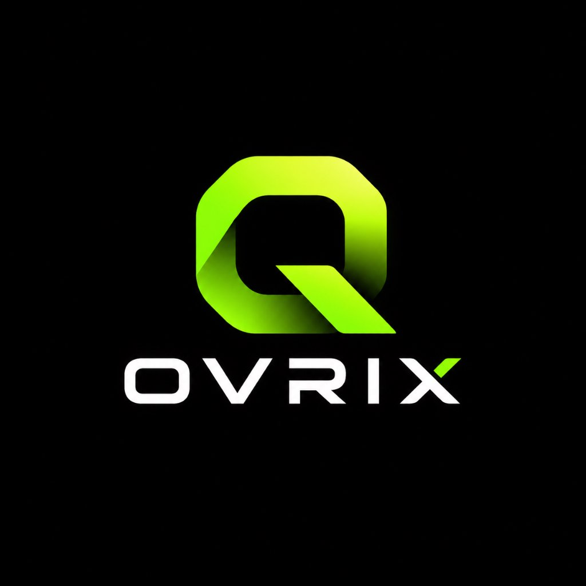

<div align="center">

  

  # QOVRIX
  ### Next-Generation In-Browser Vector Graphic Studio & Poster Engine

  <p align="center">
    <b>Zero-install. 100% Client-side. Privacy-first. Built on Vanilla HTML5 Canvas.</b>
  </p>

  <p align="center">
    <a href="#-quick-start"></a>
    <a href="#-license"></a>
    <a href="#-template-catalog"></a>
    <a href="#-architecture"></a>
  </p>

  <p align="center">
    <a href="#-features">Features</a> •
    <a href="#-templates-catalog">113+ Templates</a> •
    <a href="#-quick-start">Quick Start</a> •
    <a href="#-keyboard-shortcuts">Shortcuts</a> •
    <a href="#-architecture">Architecture</a> •
    <a href="#-license">License</a>
  </p>

</div>

---

## ⚡ Overview

**QOVRIX** is a modern, standalone web design studio crafted for creating high-impact social media assets, YouTube channel graphics, business flyers, and brand collateral right inside your browser. 

Unlike heavy web applications that require npm builds, account walls, or remote servers, **QOVRIX runs directly out-of-the-box in any modern browser** with zero installation required. It comes pre-packaged with **113+ mathematically aligned production templates**, a full vector typography system, dynamic brand identity injection, and high-resolution export.

---

## ✨ Key Features

<table>
  <tr>
    <td width="50%">
      <h3>🎨 Visual Canvas Studio</h3>
      <ul>
        <li><b>Pure 2D Canvas Engine:</b> Sub-pixel precision rendering with hardware acceleration.</li>
        <li><b>Rich Geometry & Shapes:</b> Rectangles, circles, stars, hearts, triangles, arrows, and custom badges with stroke and radius control.</li>
        <li><b>Freehand Brush Mode:</b> Real-time drawing canvas with adjustable stroke weight and dynamic palettes.</li>
        <li><b>Layer Management:</b> Move layers forward, backward, flip horizontally/vertically, and lock items.</li>
      </ul>
    </td>
    <td width="50%">
      <h3>📐 113+ Curated Templates</h3>
      <ul>
        <li><b>Golden Ratio Alignment:</b> Every template element is mathematically aligned with zero overlaps or clipping.</li>
        <li><b>Universal Aspect Ratios:</b> Standardized artboards for YouTube Banners (16:9), Thumbnails, Instagram (1:1), Stories & Reels (9:16), and Commercial Posters (4:5).</li>
        <li><b>14 Diverse Categories:</b> Esports, Tech, Crypto, Dining, Gym, Real Estate, Fashion, Events, Travel, and more.</li>
      </ul>
    </td>
  </tr>
  <tr>
    <td width="50%">
      <h3>🏢 Dynamic Brand Injection</h3>
      <ul>
        <li><b>Single-Source Brand Profile:</b> Define your business name, phone, website, signature color, and address once.</li>
        <li><b>Live Template Interpolation:</b> <code>{{BUSINESS_NAME}}</code>, <code>{{PHONE}}</code>, and <code>{{WEBSITE}}</code> automatically populate across all opened templates.</li>
        <li><b>Persistent Storage:</b> Brand configurations persist seamlessly in local storage.</li>
      </ul>
    </td>
    <td width="50%">
      <h3>🌓 Adaptive Dual Theme & Fullscreen</h3>
      <ul>
        <li><b>Cyberpunk Dark Mode:</b> Ultra-sleek neon accent palette with dark obsidian backgrounds.</li>
        <li><b>Studio Light Mode:</b> Clean, high-contrast daylight aesthetic for editorial work.</li>
        <li><b>Fluid Fullscreen Workspace:</b> One-click toggle (or press <kbd>F</kbd>) with auto-scaling responsive canvas stages.</li>
      </ul>
    </td>
  </tr>
  <tr>
    <td width="50%">
      <h3>📤 High-Resolution Export</h3>
      <ul>
        <li><b>Retina 2X PNG:</b> Lossless transparent and solid raster exports for crystal-clear social posting.</li>
        <li><b>Optimized JPG (95%):</b> Lightweight compression with high visual fidelity.</li>
        <li><b>Vector PDF:</b> Direct client-side PDF document generation via <code>jsPDF</code>.</li>
      </ul>
    </td>
    <td width="50%">
      <h3>💾 Hybrid Offline / Cloud Sync</h3>
      <ul>
        <li><b>100% Offline-First:</b> Embedded fallback catalog guarantees instant zero-latency loading even without internet.</li>
        <li><b>Optional Supabase Cloud:</b> Plug in your Supabase project in 1 minute to enable multi-device project sync and cloud authentication.</li>
      </ul>
    </td>
  </tr>
</table>

---

## 🗂️ Templates Catalog Breakdown

QOVRIX includes **113 production-ready artboards** categorized by dimension standard and business vertical:

| Category | Dimensions | Aspect Ratio | Templates | Popular Highlights |
| :--- | :---: | :---: | :---: | :--- |
| **YouTube Channel Banners** | 1200 × 675 | 16:9 | 10 | Neon Protocol, Byte & Silicon, Bull Market Alpha, Midnight Beats |
| **YouTube Thumbnails** | 1280 × 720 | 16:9 | 10 | 10X Growth Blueprint, Avoid These Disasters, $15K Dream Desk |
| **Instagram Square Posts** | 1080 × 1080 | 1:1 | 12 | Smoked Brisket Stack, Silk & Linen Drop, Skyline Penthouse, 50% Off |
| **Instagram Stories & Reels** | 1080 × 1920 | 9:16 | 10 | Midnight Flash Deal, Podcast Drop, 7-Day Shred, World Tour 2026 |
| **Corporate & Business** | 800 × 1000 | 4:5 | 10 | Strategic Advisory, Hyperscale Cloud, Legal Counsel, SaaS Analytics |
| **Food & Dining** | 800 × 1000 | 4:5 | 8 | Neapolitan Pizza, Wagyu Steakhouse, Omakase Bar, Belgian Waffles |
| **Gym, Sports & Fitness** | 800 × 1000 | 4:5 | 8 | Total Body Shred, Barbell Club, Sound Sanctuary, Fight Club Boxing |
| **Real Estate & Property** | 800 × 1000 | 4:5 | 8 | Cantilever Glass Villa, Tribeca Skyline, Oceanfront Retreat |
| **Education & Courses** | 800 × 1000 | 4:5 | 8 | Full-Stack Bootcamp, Product Design Sprint, Python Data Science |
| **Healthcare & Medical** | 800 × 1000 | 4:5 | 6 | Advanced Dental Implants, Dermatology Glow, Integrative Wellness |
| **Fashion & Luxury** | 800 × 1000 | 4:5 | 6 | Haute Couture Runway, Swiss Chronographs, Handcrafted Leather |
| **Events & Festivals** | 800 × 1000 | 4:5 | 6 | Electronic Music Festival, Rooftop Jazz Lounge, Stand-Up Comedy |
| **Travel & Tourism** | 800 × 1000 | 4:5 | 5 | Swiss Alpine Trek, Bali Wellness Sanctuary, Tokyo Cultural Tour |
| **Flash Sales & Promos** | 800 × 1000 | 4:5 | 6 | Midnight Clearance, Buy 1 Get 1 Free, Spring Warehouse Sale |

---

## ⌨️ Keyboard Shortcuts

Speed up your design workflow with built-in hotkeys:

| Shortcut | Action |
| :---: | :--- |
| <kbd>Ctrl</kbd> + <kbd>Z</kbd> | Undo canvas action |
| <kbd>Ctrl</kbd> + <kbd>Y</kbd> | Redo canvas action |
| <kbd>Delete</kbd> / <kbd>Backspace</kbd> | Delete currently selected element |
| <kbd>Arrow Keys</kbd> | Nudge selected element by 1px |
| <kbd>Shift</kbd> + <kbd>Arrow Keys</kbd> | Nudge selected element by 10px |
| <kbd>F</kbd> | Toggle distraction-free Fullscreen mode |
| <kbd>Ctrl</kbd> + <kbd>S</kbd> | Save current design to local library |
| <kbd>Esc</kbd> | Deselect element / Close modals |

---

## 📁 Repository Architecture

```
qovrix/
├── index.html              # Main QOVRIX Studio Dashboard (Explore, Hub, Library, Brand)
├── editor.html             # Visual Canvas Design Studio
├── login.html              # Authentication & User Workspace Portal
├── templates.html          # Lightweight forwarder to Templates Hub (#templates)
├── projects.html           # Lightweight forwarder to Saved Library (#library)
├── templates.json          # Complete 113+ vector template definitions catalog
├── supabase-config.js      # Offline-first fallback templates & optional Supabase client
├── qovrix-logo.jpg         # Official QOVRIX Brand Identity Logo
├── package.json            # Development server scripts and package metadata
├── package-lock.json       # Dependency lockfile
├── .gitignore              # Open-source security ignore rules
├── README.md               # Project documentation
│
├── js/                     # Studio Tool Extensions
│   ├── aiTextGenerator.js  # Client-side AI copywriter with local key storage
│   ├── autoColorPalette.js # Dynamic image & logo color palette extractor
│   ├── brandKit.js         # Business profile state manager
│   ├── magicResize.js      # Intelligent multi-ratio canvas resizer
│   └── variationsEngine.js # Algorithmic layout variation generator
│
├── database/               # SQL Database Migrations
│   ├── database-schema.sql # PostgreSQL / Supabase schema for cloud sync
│   └── sample-templates.sql# Initial database seed templates
│
├── docs/                   # Architectural & Engineering Specifications
│   ├── AUTO_SCALE_SYSTEM.md
│   ├── CANVAS_SIZING_FIX.md
│   ├── ELEMENT_ALIGNMENT_SYSTEM.md
│   ├── ELEMENT_SCALING_SYSTEM.md
│   └── ...
│
├── scripts/                # Build & Catalog Tooling
│   └── generate-100-templates.js # Mathematical template generator script
│
└── icon/                   # UI Vector SVGs & Favicon Assets
```

---

## 🚀 Quick Start

### Option 1: Direct In-Browser (Zero Installation)
Simply double-click or drag and drop [`index.html`](file:///index.html) into Google Chrome, Brave, Firefox, or Edge. Everything works completely standalone.

### Option 2: Local Development Server
To test with local HTTP protocols:

```bash
# Clone the repository
git clone https://github.com/<your-username>/qovrix.git
cd qovrix

# Start local server with npm
npm start

# Or using npx serve directly
npx serve . -l 3000
```
Open [http://localhost:3000](http://localhost:3000) in your browser.

---

## ☁️ Optional: Connecting Supabase Cloud

By default, QOVRIX runs in **100% offline mode** using browser local storage and embedded catalogs. If you wish to enable cross-device cloud persistence:

1. Create a free account at [Supabase](https://supabase.com).
2. Open your Supabase SQL Editor and run the script in [`database/database-schema.sql`](file:///database/database-schema.sql).
3. In [`supabase-config.js`](file:///supabase-config.js), update your credentials or set them via browser storage:
   ```javascript
   localStorage.setItem('qovrix_supabase_url', 'https://your-project.supabase.co');
   localStorage.setItem('qovrix_supabase_anon_key', 'your-anon-key');
   ```

---

## 🛠️ Tech Stack

- **Core Engine:** Vanilla HTML5 Canvas 2D API (`canvas.getContext('2d')`)
- **Frontend Architecture:** Vanilla ES6+ JavaScript, CSS3 Variables, Responsive Flexbox & CSS Grid
- **Typography:** Google Fonts (`Plus Jakarta Sans`, `Montserrat`, `JetBrains Mono`, `Space Grotesk`, `Inter`)
- **Iconography:** FontAwesome 6.4.0 & Custom SVG vector packs
- **Client Export:** `html2canvas` & `jspdf`
- **Optional Backend:** Supabase (PostgreSQL, Auth, Realtime)

---

## 🤝 Contributing

Contributions are welcome! If you have ideas for new templates, typography presets, or editor tools:

1. Fork the Project
2. Create your Feature Branch (`git checkout -b feature/AmazingFeature`)
3. Commit your Changes (`git commit -m 'Add some AmazingFeature'`)
4. Push to the Branch (`git push origin feature/AmazingFeature`)
5. Open a Pull Request

---

## 📄 License

Distributed under the **MIT License**. See `LICENSE` for more information.

---

<div align="center">
  <sub>Engineered with precision for creators and developers by the <b>QOVRIX Studio Team</b>.</sub>
</div>
